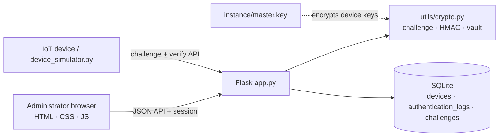

# IoTShield – Secure Device Authentication Using HMAC

A working web application that shows how **cryptography can authenticate IoT devices**
before they are allowed to use a server.

---

## Problem Statement

IoT devices (sensors, cameras, GPS trackers, smart locks…) connect to servers over
networks that anyone can listen to. If a server simply trusts a device ID, or a
password that travels over the network, then:

* an attacker can **pretend to be a real device** (spoofing / impersonation),
* an attacker can **record a valid login and send it again** (replay attack),
* a leaked shared password gives access to every device.

The server needs a way to check that a device really owns a secret **without the
secret ever crossing the network**.

## Objective

Use **Challenge–Response authentication with HMAC-SHA256** so that:

1. only devices that hold the correct secret key are accepted,
2. the secret key is never transmitted,
3. an old (recorded) response is useless, and
4. every attempt is stored in a security log that the administrator can review.

## Technologies Used

| Layer | Technology |
|---|---|
| Backend | Python 3, Flask |
| Database | SQLite |
| Cryptography | HMAC, SHA-256 (`hmac`, `hashlib`), `secrets`, Fernet and Ed25519 signatures (`cryptography` package) |
| Frontend | HTML5, CSS3, JavaScript (no external libraries). Fonts (Inter Tight, Instrument Serif, JetBrains Mono) load from Google Fonts when online; offline, the app still works and falls back to system fonts |

## Authentication Algorithm

```
Device                                   Server
  | ---- "I am TEMP-001" --------------->  |   1. request
  |                                        |   2. challenge = 32 random bytes (secrets)
  | <---- challenge ----------------------  |      (stored, valid once, 2 minutes)
  | 3. response = HMAC-SHA256(key, challenge)
  | ---- response ----------------------->  |   4. look up the device's key
  |                                        |   5. expected = HMAC-SHA256(key, challenge)
  |                                        |   6. hmac.compare_digest(expected, response)
  | <---- ACCESS GRANTED / DENIED --------  |   7. result written to the security log
```

Why it is secure:

* **The key is never sent** – only the HMAC of a random challenge is.
* **Fresh challenge every time** – a recorded response is useless (*replay protection*:
  each challenge works once and expires after 2 minutes).
* **Constant-time comparison** (`hmac.compare_digest`) – no timing side channel.
* **Keys are encrypted in the database** (Fernet = AES + HMAC) with a master key stored
  in a separate file, so a stolen `database.db` alone reveals no device key.
* **Automatic sign-out:** the admin is signed out after **5 minutes of inactivity**, when the page is **reloaded** (a refresh also takes you back to the opening screen), or when the browser is closed. The dashboard's automatic refreshes do not count as activity.
* **Keys are never sent to the browser** – the UI shows only `••••••••`.

All cryptography lives in one small file: [`utils/crypto.py`](utils/crypto.py).

## Security Analysis

A good viva question is "how secure is this, really?" - here are the actual numbers.

### Key space and brute-force time

Each device secret key is **256 bits**, generated with `secrets.token_hex(32)` (the operating
system's cryptographically secure random source). The number of possible keys is:

```
2^256 ≈ 1.16 × 10^77
```

To put that in perspective: the observable universe is estimated to contain around 10^80
atoms, and it is about 13.8 billion years old (≈ 4.4 × 10^17 seconds). Suppose an attacker had
hardware that could compute **10^18 full HMAC-SHA256 guesses every second** - vastly beyond
anything that exists today (that is roughly the speed of the world's fastest supercomputers
added together, and each "guess" here is a full cryptographic hash, not a single instruction).
Exhausting the key space would still take:

```
1.16 × 10^77 keys ÷ 10^18 guesses/sec  ≈  1.16 × 10^59 seconds  ≈  3.7 × 10^51 years
```

That is about **10^41 times the current age of the universe**. In short: brute-forcing a
device's key is not "very hard", it is physically meaningless with any hardware that could
plausibly exist. This is why device authentication in this project needs **no rate limiting to
remain cryptographically safe** - the rate limiting on `/api/device/verify` (below) exists for
other reasons, not because the key is guessable.

### Why the 2-minute challenge expiry still matters

If the key cannot be brute-forced, why bother expiring challenges? Because expiry defends
against different problems, not weak keys:

* **Limits the blast radius of a bug.** If the "used" flag were ever bypassed by a coding
  mistake, a short expiry still caps how long a captured (challenge, HMAC) pair stays useful.
* **Bounds resource use.** Without expiry, the `challenges` table would grow forever and the
  server would have to consider every challenge it has ever issued as still "live".
* **Matches the threat model.** A device is expected to answer within seconds. A response that
  arrives two minutes late is far more likely to be a replayed or stalled message than a slow
  network, so rejecting it is a safe default.
* **General security principle.** Limiting *how long* a credential is valid, in addition to
  limiting *what* it can do, is defense in depth: two independent protections (single-use +
  short expiry) both have to fail for a replay to succeed, not just one.

### What an attacker without the key can and cannot do

| | |
|---|---|
| **Cannot** | Compute a valid HMAC for a new challenge (needs the 256-bit key - see above) |
| **Cannot** | Replay a previously valid (challenge, HMAC) pair (single-use + 2-minute expiry) |
| **Cannot** | Recover a device's key from a stolen `database.db` (keys are Fernet-encrypted with a master key kept in a separate file) |
| **Cannot** | Tell which part of a wrong HMAC was correct (constant-time comparison, no timing side-channel) |
| **Can** | See that a device ID exists - IDs are not secret, only the key is |
| **Can** | Send malformed or guessed requests - now rate-limited and logged (see below) |
| **Can**, only without HTTPS | Passively observe challenge/response traffic on the network (does not reveal the key, but is a real gap - see Limitations) |

### Rate limiting: why it matters for the 6-digit login code but not for HMAC

This project rate-limits two different things, for two different reasons:

| | Key space | Codes "live" at once | Chance per blind guess | Needs rate limiting to be safe? |
|---|---|---|---|---|
| Device HMAC (`/api/device/verify`) | 2^256 (see above) | 1, and only briefly | ≈ 0 (not computable) | **No** - safe by math alone |
| Admin 2FA code (`/login`) | 10^6 (six digits) | 1 at a time | 1 in 1,000,000 (0.0001%) | **Yes** |

A 6-digit code is a *human-friendly* secret, not a cryptographic one - 10^6 is a number a
computer can try in well under a second with no rate limiting at all. That is exactly why:

* the admin login locks out after **5 failed attempts within 60 seconds** (whether the failures
  are a wrong password, a wrong code, or a mix - both stages share one counter),
* each mailed code also stops working after **5 wrong guesses of its own** (defense in depth, in
  case the IP-based counter above is ever bypassed - e.g. a stolen session cookie used from
  another network), and
* a code cannot be **replayed**: it is deleted the moment it is accepted, and expires after 10
  minutes even if it is never used.

With the 5-attempt lockout, an attacker's cumulative chance of guessing a valid code before
being locked out is only **5 in 1,000,000 (0.0005%)** per lockout window - low, but only *because*
of the rate limit, unlike the HMAC case above where the limit is mathematical, not procedural.

Device authentication is rate-limited too (`MAX_DEVICE_AUTH_FAILURES = 5` failures locks that
device out for 60 seconds), but this is defense in depth against attack traffic, log spam and
buggy clients - not because the underlying HMAC-SHA256 needs help to stay secure.

## Signed Firmware Updates

Authenticating a device proves *who* it is. It says nothing about *what software it runs*.
Attackers often take over IoT devices by getting them to install malicious firmware: an
altered image sent through a compromised network or mirror, or an old genuine version with
a known hole. The **Firmware** page closes that gap with **Ed25519 digital signatures**.

### Why signatures here, not HMAC?

HMAC needs the *same* secret on both sides. If devices checked firmware with HMAC, every
device would hold a key that can also **create** valid firmware. An attacker who pulls that
key off one cheap sensor could push malware to the whole fleet. A digital signature splits
the key in two:

| | HMAC (device login) | Ed25519 signature (firmware) |
|---|---|---|
| Keys | one shared secret per device | private key (server) + public key (every device) |
| Who can create a valid tag/signature | server **and** that device | **only** the server |
| Stealing the device's key gives an attacker… | that one device's identity | nothing: the public key can only verify |
| Fits | one device ↔ one server | one publisher → thousands of devices |

### The protocol

```
Admin uploads image ──► server computes  h = SHA-256(image)
                        signs  "IoTShield-firmware|v1|<version>|<h>"  with its PRIVATE key

Device ── GET /api/device/firmware/latest ──► { version, sha256, signature, image_url }
Device ── GET image_url ─────────────────────► the image bytes
Device:  1. h' = SHA-256(downloaded image)
         2. verify(signature, "IoTShield-firmware|v1|<version>|<h'>")  with the PUBLIC key
            built into the device at the factory
         3. refuse anything OLDER than what is installed (anti-rollback)
Device ── POST /api/device/firmware/report ──► { version, outcome, challenge, HMAC }
          (the report is authenticated with the device's HMAC key, so nobody else can
           claim a device was patched)
```

The version is **inside** the signed text on purpose. If only the image hash were signed,
an attacker could take an old, genuinely signed image with a known bug and present it as
the newest version. The signature check would still pass.

### Attacks the demo shows being blocked

| Button | What the attacker does | Stopped by |
|---|---|---|
| Tamper one bit | changes a single bit of the image in transit | SHA-256 changes, so the signature fails |
| Attacker-signed | signs their own image with their own private key | device only trusts IoTShield's public key |
| Relabel old as new | sends genuine old firmware labelled as the latest version | version is part of the signed text |
| Downgrade | sends genuine, correctly signed **older** firmware | anti-rollback check (signature passes!) |

Every attempt, accepted or refused, appears in the **Update Log**. The **Device Fleet** table
shows which devices are behind the latest release.

### Keys

* `instance/firmware_signing.key`: the Ed25519 **private** key (PEM, file mode 600). It is
  created on first launch, never leaves the server and is never sent to the browser.
* `instance/firmware_signing.pub`: the matching **public** key (hex). This is what a
  manufacturer would burn into each device; `device_simulator.py` reads it from here.

## Key Custody: Shamir's Secret Sharing

Every device key in the database is encrypted with one **master key**. Whoever steals the
master key file *and* the database can read every device key, so that single file is the most
valuable thing on the server. The **Key Custody** page gives it three layers of protection.

**Treasure map in pieces.** Tear a treasure map into 5 pieces and give each to a different
person. Any 3 pieces fit together and show where the treasure is. With only 2 pieces you
learn nothing, not even a hint. That is Shamir's Secret Sharing (a "3-of-5" scheme here).

### How the maths works (the viva answer)

Two points make exactly one straight line; three points make exactly one parabola; *k* points
make exactly one curve of degree *k-1*.

1. **Split.** Build a random curve of degree *k-1* whose height at x = 0 *is the secret key*.
   Hand out its heights at x = 1, 2, … *n*. Each `(x, height)` pair is one share.
2. **Rebuild.** Any *k* shares pin the curve down (Lagrange interpolation), so read its height at x = 0.
3. **Fewer than *k* shares.** Infinitely many curves fit them, and every possible secret is
   *equally likely*. The shares reveal nothing, however much computing power an attacker has.
   (The page shows this: test with 2 shares and it reports random data, not a key.)

The arithmetic is done modulo the prime 2^521 - 1 (a Mersenne prime), using `secrets` for the
random numbers. The whole thing is about 100 lines in [`utils/shamir.py`](utils/shamir.py).

A share looks like `IOTS1-3-5-4b56195c-2-<132 hex digits>-<8 check digits>`: the format version,
*k*, *n*, a random ID of the split (so shares from different splits cannot be mixed), the share
number, the value, and a checksum, so a typo is caught immediately instead of quietly giving a wrong key.

### Split, seal, unseal

| Step | What it does | What it protects against |
|---|---|---|
| **Split** | The master key becomes *n* shares. They are shown once and **never stored** on the server. Needs the administrator password. | One person (or one file) holding the key |
| **Test** | Paste shares and see whether they rebuild this server's key. The key itself is never shown. | Finding out the shares are wrong *after* the key is gone |
| **Seal** | Deletes `instance/master.key`. The server forgets the key and from then on starts **sealed**. Needs the password, the word `SEAL`, **and enough valid shares**, so you must prove you can get the key back before it is deleted. | A stolen disk, backup or copy of the project folder: it now holds only encrypted device keys |
| **Unseal** | After a restart, enter *k* shares. The key is rebuilt **in memory only**, never written back to disk. | Needing the key file on disk to run |
| **Restore** | Writes the key back to `master.key` and switches sealed mode off. | Being stuck in sealed mode |
| **Rotate** | Makes a **brand-new** master key, re-encrypts every device key with it, and issues new shares. The old shares then rebuild a key that opens nothing. | A leaked share (see "Rotating the master key" below) |

While sealed, the server still runs and the administrator can still log in, but anything that
needs a device key (device authentication, adding a device, the simulators) answers
`503 The key vault is sealed`, and every page shows a warning banner. Nothing is half-done:
the check happens before a challenge is used up or a request is logged.

**The safety rule that matters most:** the old code created a *new* random key whenever
`master.key` was missing. After sealing, that would quietly produce a key that cannot decrypt a
single device key. So the vault keeps a small non-secret note, `instance/vault.json` (the key's
fingerprint, the split settings, and whether it is sealed), and **a sealed vault never creates a
key**. A key file put back by hand is accepted only if its fingerprint matches.

### Rotating the master key

If a share may have leaked, **rotate**: the administrator enters the password and the number of
new shares, and the app does this:

1. makes a brand-new random master key,
2. decrypts every device key with the old master key and re-encrypts it with the new one,
3. issues new shares (shown once, like any split), and
4. removes the old key. The old shares now rebuild a key that opens nothing (test them on the page: "No match").

Rotation is the riskiest thing in the project (a bug could destroy every device key), so it is
built to be **all-or-nothing and crash-safe**:

* The re-encryption of all device keys happens in **one database transaction**. Each re-encrypted key is
  read back and compared with the original before anything is committed. If *any* key cannot be
  decrypted, or anything else goes wrong, the transaction is rolled back and the old key stays.
* For the short moment of the swap, `instance/master.key` holds **both** keys (new first, using
  Fernet's `MultiFernet`). So at every instant, whatever a crash leaves behind, **every device key can
  still be opened**. The old key is removed only after the database is committed and the new
  shares' settings are recorded.
* If the server dies in the middle, the next start sees a two-key file and **finishes the rotation by
  itself** (re-encrypting is safe to repeat). Because the new shares were never shown, they are
  forgotten and the administrator makes new ones.
* While keys are swapped, a lock holds back every request that uses the master key (logins, adding
  a device), so none can be half-done. A test proves it: with the lock switched off, a device logging
  in during a rotation fails; with it, 25 runs in a row all succeed.
* A **safety copy of the database** is saved first by default (`instance/backups/`, owner-only). It is
  protected by the **old** key, so it keeps the old shares useful: delete it when you are satisfied.

**What rotation does *not* do.** It limits a leaked share's damage to the *past*: from the moment of
rotation, those shares open nothing. It cannot undo a copy of the database that was **already
stolen** (together with enough old shares, that copy can still be decrypted), and it does **not
change the devices' own secret keys**, it only re-wraps them. If a leak may have reached the
database too, also issue new keys to the affected devices. Rotation needs the key to be stored in
its file, so in sealed mode use "Write key back to file" first, rotate, then seal again with the new shares.
The firmware signing key and the web-session key are separate and are not rotated by this.

### Recovering without the web app

```bash
python key_custody.py recover --fingerprint 3f9a:1c07:b24d:e810
```

Type or paste the shares (they are read from the keyboard, not from arguments, so they stay out of
your shell history). It rebuilds `instance/master.key` and refuses to overwrite an existing file
unless you pass `--force`. The fingerprint option makes sure the shares belong to the right key.

### What this does and does not do

* **It does** remove the single point of failure: no one person and no file holds the key, and
  losing the key file is no longer fatal (any *k* shares rebuild it).
* **Sealing is optional.** Splitting alone does *not* protect a key file that is still on the disk,
  because anyone who copies the file does not need the shares. Sealing is what removes the file.
* **New shares from a *split* do not cancel old ones.** Shares from different splits of the same key
  all rebuild that same key. To cancel a leaked share, **rotate** the master key (see above).
* **Lose too many shares and the device keys are gone for good.** That is why Seal makes you prove
  you hold enough valid shares first.
* **A sealed server needs a person after every restart** (to enter the shares). That is the point,
  but it does mean it is not suited to unattended automatic restarts.
* The firmware signing key and the web-session key are separate files and are *not* covered by this.
* Deleting a file does not guarantee the bytes are gone from the physical disk (a real
  deployment would use an HSM or a key-management service, as listed under Limitations).
* `device_simulator.py` reads device keys using the key file, so it cannot be used while sealed.

## Project Architecture



```text
IoTShield/
├── app.py                  Flask routes + authentication protocol
├── device_simulator.py     acts as a real IoT device over HTTP (for demos)
├── key_custody.py          rebuild the master key file from shares (offline)
├── test_iotshield.py       automated tests
├── requirements.txt
├── .env                    demo admin login (edit me)
├── .env.example
├── README.md
├── database/               database.db is created automatically
├── instance/               master.key, session key, firmware signing key pair
│                           vault.json (non-secret key-custody note, created when you split)
│                           backups/ (database copies made before a key rotation)
│                           (created automatically, keep private)
├── templates/              login, splash, dashboard, devices, authentication,
│                           logs, device_details, firmware, key custody, about, error
├── static/
│   ├── css/  style.css, splash.css
│   ├── js/   script.js, splash.js
└── utils/
    ├── crypto.py           ← all the cryptography
    ├── shamir.py           Shamir's secret sharing (pure maths)
    ├── custody.py          sealed / unsealed vault, the "never invent a key" rule
    └── database.py         schema + demo data
```

## Installation

Requires **Python 3.9 or newer**. Open a terminal in the `IoTShield` folder.

Create a virtual environment:

```bash
python -m venv venv
```

Activate it – macOS / Linux:

```bash
source venv/bin/activate
```

Windows:

```bash
venv\Scripts\activate
```

Install the requirements:

```bash
pip install -r requirements.txt
```

Run the app:

```bash
python app.py
```

Now open **http://127.0.0.1:5001** in your browser. You will see the animated IoTShield
opening screen, then the login page.

> On macOS/Linux you may need `python3` and `pip3` instead of `python` and `pip`
> (outside the virtual environment).

## Demo Credentials

The administrator login is read from **environment variables**, not from the source code.
For convenience they are provided in the `.env` file, which the app loads on start:

```text
IOTSHIELD_ADMIN_USER=admin
IOTSHIELD_ADMIN_PASSWORD=admin@123
```

Change them by editing `.env`, or set them in your terminal instead
(a real environment variable overrides `.env`):

```bash
export IOTSHIELD_ADMIN_PASSWORD="my-own-password"     # macOS / Linux
set IOTSHIELD_ADMIN_PASSWORD=my-own-password          # Windows (cmd)
```

If no password is configured at all, the app generates a random one and prints it in the
terminal.

### Two-factor authentication (email code)

Logging in is two steps: your password, then a random 6-digit code that the server emails to
`IOTSHIELD_ADMIN_EMAIL` through Gmail. Unlike a TOTP app, this code is not derived from any
shared secret - the server picks it with `secrets.randbelow` (the same secure RNG used for
device keys and challenges), remembers it in memory, and checks it against whatever you type
back in. It is single-use, expires after 10 minutes, and stops working after 5 wrong guesses.

To send real emails, put these in `.env` (see `.env.example`):

```text
IOTSHIELD_ADMIN_EMAIL=you@gmail.com             # where the code is sent (the "given gmail")
IOTSHIELD_SMTP_EMAIL=you@gmail.com              # Gmail account that sends it (can be the same one)
IOTSHIELD_SMTP_PASSWORD=<16-character App Password>
```

`IOTSHIELD_SMTP_PASSWORD` must be a Gmail **App Password**, not your normal Gmail password -
Google no longer accepts real passwords for this over plain SMTP. To create one: turn on
**2-Step Verification** on the Gmail account (Google Account → Security), then go to
**App passwords**, create one for "Mail", and paste the 16-character result in. Sending and
receiving can be the same Gmail address (the account emails a code to itself).

**No Gmail setup needed for the demo.** If those three variables are left out, or sending fails
for any reason (wrong app password, no internet, ...), IoTShield cannot get stuck: the code is
shown directly on the login page instead, in an amber "Could not send the email" box, and a
message is printed to the terminal explaining why. This is a classroom fallback, clearly
labelled as such - turn it off for anything resembling a real deployment with
`IOTSHIELD_EMAIL_OTP_SHOW_FALLBACK=false`.

Two independent switches:

```text
IOTSHIELD_EMAIL_OTP_ENABLED=false        # turn 2FA off entirely (password-only login)
IOTSHIELD_EMAIL_OTP_SHOW_FALLBACK=false  # never show the code on the page, even if the email fails
                                          # (closer to how a real deployment should behave)
```

There is also a "Resend code" link on the code-entry page in case the email is slow to arrive
(rate-limited to one every 30 seconds).

## Demo Data

On the first launch the app creates four **demo devices** (`TEMP-001`, `CAM-002`,
`MOT-003`, `GPS-004`) with securely generated keys and about a day of sample
authentication history. Everything generated this way carries a **DEMO** badge and a
banner on the dashboard says so.

It also publishes three genuinely signed demo firmware releases (`1.0.0`, `1.1.0`, `1.2.0`).
`CAM-002` starts on 1.1.0 and `MOT-003` on 1.0.0, so there is something to update straight
away. An existing database is upgraded automatically the first time you start this version.

To start again from scratch, stop the app and delete the `database/database.db` **and**
`instance/` folder, then start it again.

## Running the tests

```bash
python test_iotshield.py
```

The tests use a temporary database and cover login, two-factor authentication (correct/wrong/
replayed codes), device-authentication rate limiting, adding devices, random challenges,
correct HMAC → success, wrong HMAC → failure, replay, expiry, disabled devices, logging,
CSRF, secret-key leakage, the 5-minute inactivity sign-out, and signed firmware updates
(tampered / attacker-signed / relabelled / downgraded images refused, HMAC-authenticated device
reports, replayed reports, upload validation, private key never exposed, database upgrade), and
key custody (every group of *k* shares rebuilds the key and no group of *k-1* does, typos and mixed
splits are caught, the full seal / refuse / unseal / restore cycle, a sealed vault never invents a
key), and master-key rotation (every device key survives, old shares open nothing, one bad key or a
failure at any step changes nothing, a crash before or after the commit heals itself, logins during a
rotation never fail). 88 tests in total.

## Extra: the device simulator

While the app is running, in a second terminal (with the virtual environment active):

```bash
python device_simulator.py TEMP-001
python device_simulator.py TEMP-001 --attacker
python device_simulator.py TEMP-001 --replay
```

It behaves like a real device: it asks for a challenge over HTTP, computes the HMAC, and
sends it back. Watch the dashboard and Security Logs update.

If IoTShield runs on another port (set `PORT=5101` when starting it), point the simulator at it with
`--server http://127.0.0.1:5101` or `export IOTSHIELD_SERVER=http://127.0.0.1:5101`.

Firmware updates, run exactly as a device would (download, verify the signature with the
built-in public key, refuse older versions, then send an HMAC-authenticated report):

```bash
python device_simulator.py MOT-003 --update
```

```bash
python device_simulator.py CAM-002 --update --tamper
```

The second one flips a bit of the download, as a man-in-the-middle would. The device refuses
it, and the refusal appears in the Firmware page's Update Log.

## Limitations (good to mention in the viva)

* Flask's built-in development server is used; a real deployment needs HTTPS and a
  production server, otherwise the challenge/response can be observed (it cannot be
  reused, but it is not hidden).
* The device firmware is simulated (`Generate HMAC` button / `device_simulator.py`).
* The master key is kept in a file by default (it can be split and sealed, see Key Custody);
  production systems would use a hardware security
  module or a key-management service. The same goes for the firmware signing key, which in
  practice is often kept offline and used only at release time.
* Firmware "installation" is simulated (the device's recorded version changes). There is
  one release line for all device types, and a real device would also need a secure boot
  chain to check the firmware again at every power-on.
