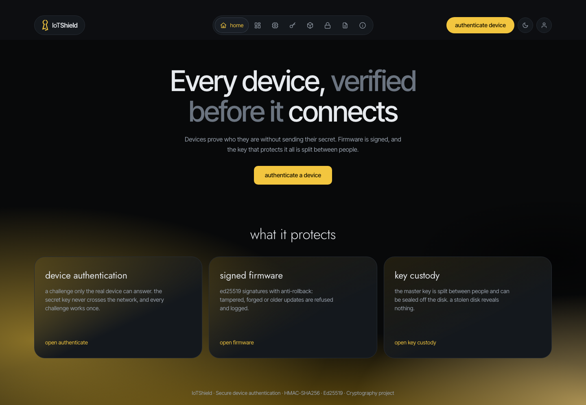
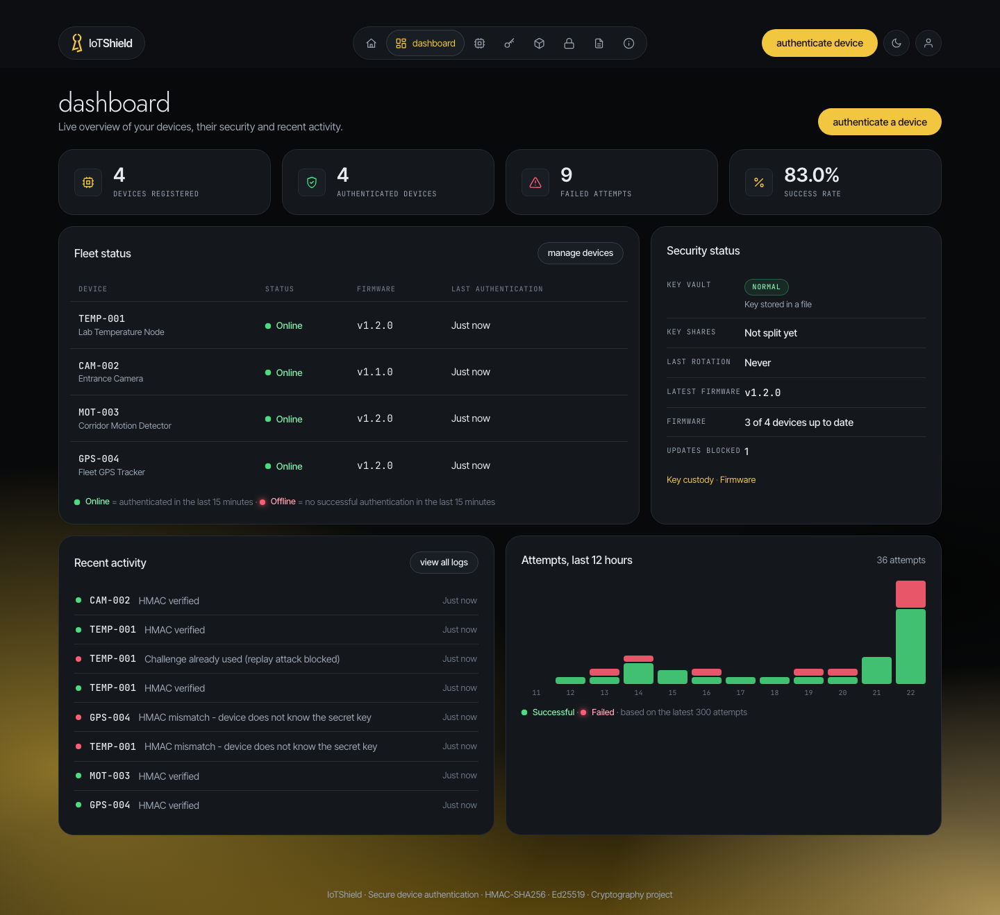
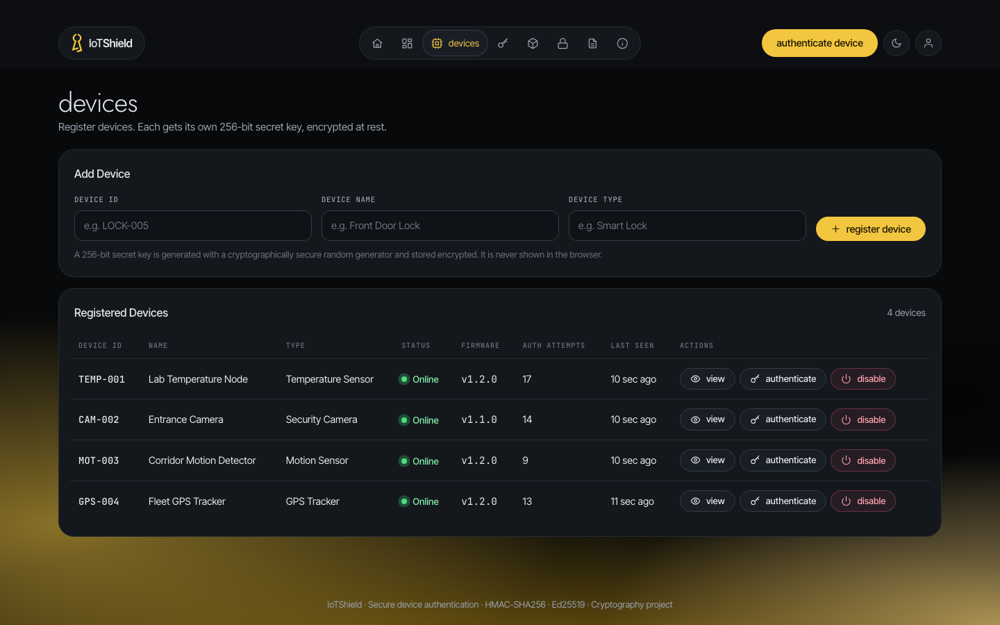
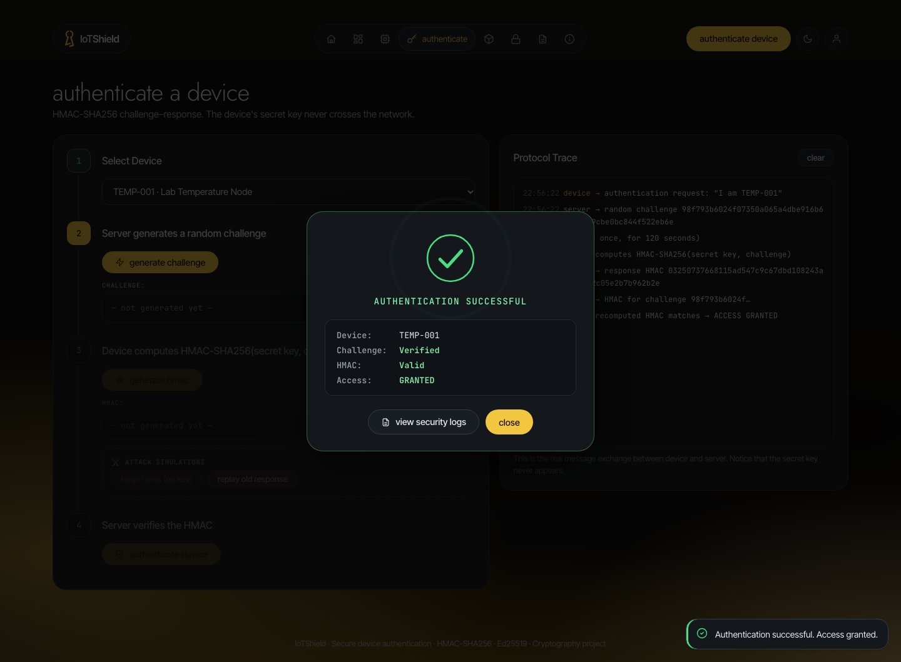
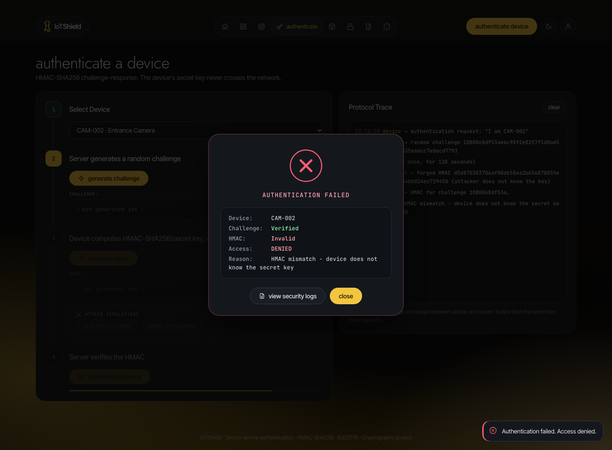
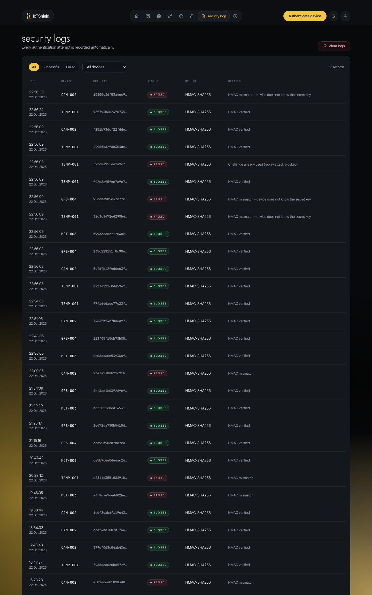
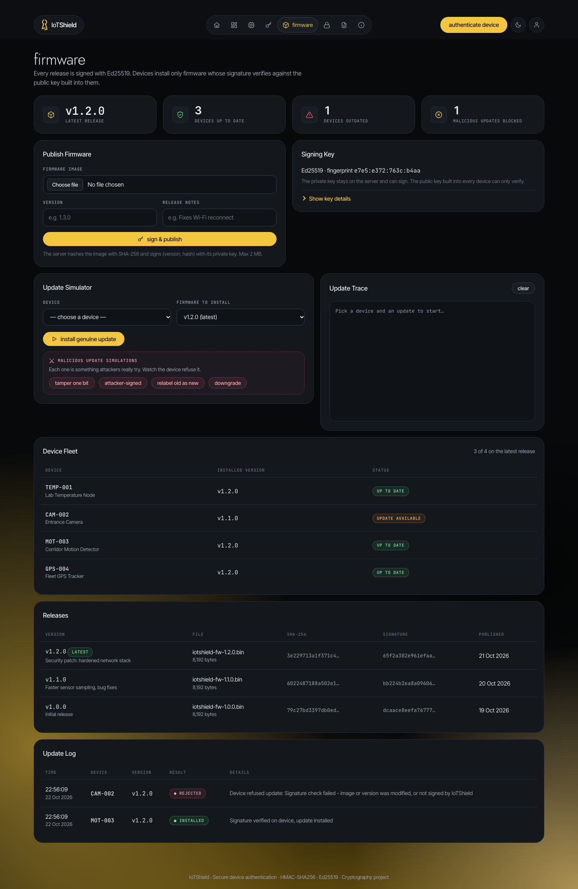
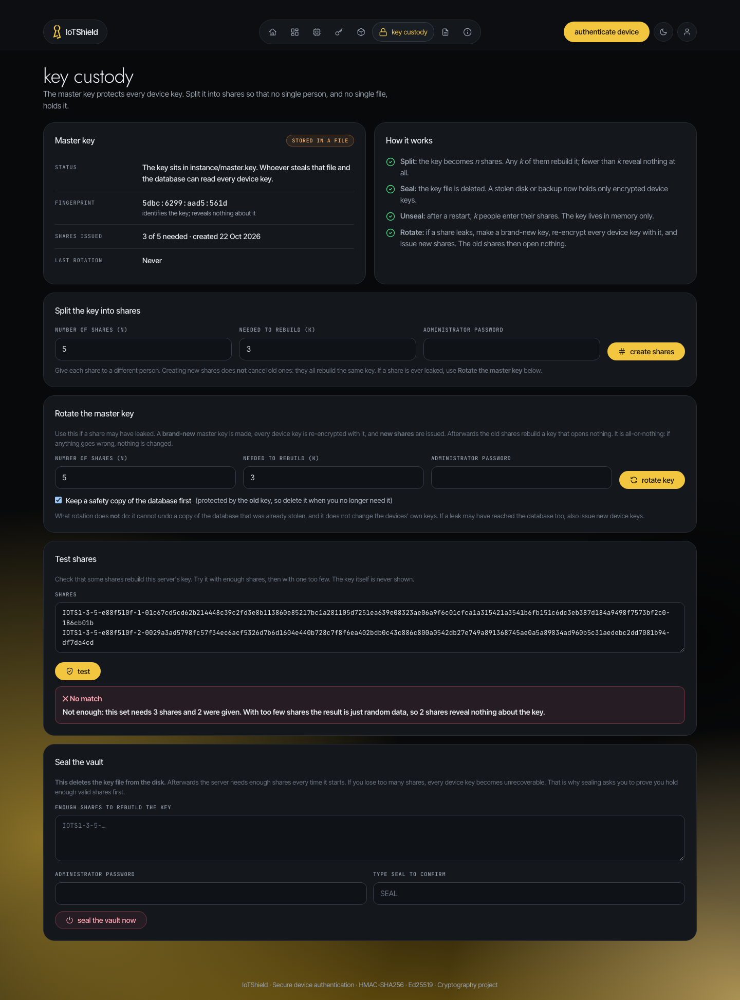

# IoTShield: Secure IoT Device Authentication, Signed Firmware and Key Custody

A web application that shows how **cryptography can protect an IoT fleet**: devices prove who they are without sending their secret, firmware updates cannot be forged or downgraded, and the key that protects every device secret is split between people so that a stolen disk reveals nothing.

Built as a **Cryptography mini project** by **Gargi Deore** and **Diya Jairamani**, using Python, Flask and SQLite.

---

## Project Overview

IoT devices (sensors, cameras, GPS trackers, smart locks) talk to servers over networks that anyone can listen to. A server that simply trusts a device ID, or a password that travels over the network, is open to:

- **Spoofing**: an attacker pretends to be a real device.
- **Replay**: an attacker records a valid login and sends it again.
- **Malicious firmware**: a tampered, forged or outdated update is installed.
- **Key theft**: one stolen file decrypts every device secret.

IoTShield answers each of these with a standard cryptographic technique and lets the administrator watch it work on a live dashboard.

| Threat | Defense | Technique |
|---|---|---|
| Spoofing | The device proves it holds its key without sending it | HMAC-SHA256 challenge–response |
| Replay | Every challenge works once and expires after 2 minutes | Random single-use challenges |
| Bad firmware | Only correctly signed, newer firmware is installed | Ed25519 signatures + anti-rollback |
| Stolen database | Device keys are stored encrypted | Fernet (AES + HMAC) |
| Stolen key file | The master key is split among people, can be removed from disk, and can be replaced | Shamir's Secret Sharing, sealing, rotation |

---

## Features

- Device authentication with HMAC-SHA256 challenge–response
- Replay protection (single-use challenges, 2-minute expiry) and constant-time comparison
- Per-device lockout after repeated failures
- Device keys encrypted in the database and never sent to the browser
- Ed25519 signed firmware, with the version inside the signed text
- Anti-rollback: older firmware is refused even when its signature is valid
- **Key Custody:** split the master key into shares (default 3-of-5), seal the vault so the key file is deleted from disk, unseal with enough shares
- **Master-key rotation:** a crash-safe, all-or-nothing re-encryption that makes leaked shares useless
- Admin protection: password plus emailed 6-digit code, CSRF tokens, rate limiting, 5-minute inactivity sign-out
- **Home** landing page after login, and a live **Dashboard** with device counters, fleet status, key-vault and firmware status, recent activity and an hourly attempts chart
- Device list, firmware page with update log, and a full security log
- Light and dark theme, with icon navigation (hover an icon to see its name)
- Device simulator for demos, including attack modes
- 88 automated tests

---

## System Workflow

### Device authentication

```text
Device                                      Server
  |  ---- "I am TEMP-001" ------------------>  |
  |                                            |  challenge = 32 random bytes (single-use, 2 min)
  |  <---- challenge --------------------------|
  |  response = HMAC-SHA256(key, challenge)    |
  |  ---- response --------------------------> |  expected = HMAC-SHA256(key, challenge)
  |                                            |  hmac.compare_digest(expected, response)
  |  <---- ACCESS GRANTED / DENIED ----------- |  result written to the security log
```

The secret key is never transmitted.

### Signed firmware

```text
Admin uploads image  -->  server signs  "IoTShield-firmware | version | SHA-256(image)"
                          with its PRIVATE key (Ed25519)

Device downloads image, then:
   1. recomputes SHA-256 of the image
   2. verifies the signature with the PUBLIC key built into the device
   3. refuses anything older than the installed version
   4. reports the outcome, authenticated with its HMAC key
```

### Key custody

```text
 master key --Split--> 5 shares (any 3 rebuild it, 2 reveal nothing)
      |
      +--Seal--> master.key deleted from disk, server starts sealed
      |
      +--Unseal (3 shares)--> key rebuilt in memory only
      |
      +--Rotate--> new key, every device key re-encrypted in one transaction, new shares issued
```

---

## Technologies Used

| Layer | Technology |
|---|---|
| Backend | Python 3, Flask |
| Database | SQLite |
| Cryptography | `hmac`, `hashlib`, `secrets`; Fernet and Ed25519 from the `cryptography` package; Shamir's Secret Sharing over the prime 2^521 − 1 (own implementation) |
| Frontend | HTML5, CSS3, JavaScript (no external libraries) |

---

## Pages

| Page | Purpose |
|---|---|
| Home | Landing page after login, with shortcuts to authentication, firmware and key custody |
| Dashboard | Devices registered, authenticated and failed, success rate, fleet status, security status (key vault, firmware), recent activity and an hourly attempts chart |
| Devices | Add, view and manage devices |
| Authenticate | Run the 4-step challenge–response step by step |
| Firmware | Publish signed firmware, view the update log and fleet versions |
| Key Custody | Split, test, seal, unseal and rotate the master key |
| Security Logs | Every authentication attempt, accepted or refused |
| About | How the system works |

---

## Screenshots

### Home
The landing page after login, with shortcuts to the main areas.



### Dashboard
Devices registered, authenticated and failed, the success rate, fleet status, security status (key vault and firmware), recent activity, and an hourly chart of successful and failed attempts.



### Devices
Register and manage devices. Each gets its own 256-bit secret key, stored encrypted and never shown in the browser.



### Device authentication: access granted
The four-step challenge–response with the protocol trace. The secret key never appears in the trace.



### Device authentication: access denied
A forged HMAC (wrong key) is rejected.



### Security logs
Every attempt is recorded, including forged responses and blocked replays.



### Signed firmware
Publishing, the Ed25519 signing key, the update simulator with the four malicious-update buttons, the fleet table, releases and the update log with a refused update.



### Key custody
The master key's status, splitting into shares, rotation, and the share test. With only 2 of the 3 required shares, the test reports "No match" and reveals nothing about the key.



---

## Project Structure

```text
IoTShield/
├── app.py                  Flask routes and the authentication protocol
├── device_simulator.py     Acts as a real IoT device over HTTP (for demos)
├── key_custody.py          Rebuild the master key from shares (offline)
├── test_iotshield.py       Automated tests
├── requirements.txt
├── .env.example            Copy to .env and edit
├── database/               database.db is created automatically
├── instance/               Keys and key-custody note (created automatically, keep private)
├── templates/              HTML pages
├── static/
│   ├── css/                style.css, splash.css
│   ├── js/                 script.js, splash.js
│   └── assets/             logo.svg
├── utils/
│   ├── crypto.py           All the cryptography
│   ├── shamir.py           Shamir's Secret Sharing
│   ├── custody.py          Sealed / unsealed vault logic
│   └── database.py         Schema, demo data, key re-encryption
└── docs/
    ├── TECHNICAL-NOTES.md  Detailed security analysis and design notes
    └── images/             Screenshots used in this README
```

---

## Installation

Requires **Python 3.9 or newer**. Open a terminal in the `IoTShield` folder.

**1. Create and activate a virtual environment**

```bash
python -m venv venv
```

macOS / Linux:

```bash
source venv/bin/activate
```

Windows:

```bash
venv\Scripts\activate
```

**2. Install the requirements**

```bash
pip install -r requirements.txt
```

**3. Create your settings file**

Copy `.env.example` to `.env`:

```bash
cp .env.example .env
```

Then open `.env` and set your own administrator password:

```text
IOTSHIELD_ADMIN_USER=admin
IOTSHIELD_ADMIN_PASSWORD=choose-a-password
```

> The `.env` file holds secrets and is not part of the repository. Never commit it.

**4. Run the app**

```bash
python app.py
```

Open **http://127.0.0.1:5001**. You will see the opening screen, then the login page. Set the `PORT` environment variable to use a different port.

> On macOS/Linux you may need `python3` and `pip3` outside the virtual environment.

### Two-factor login

After the password, a random 6-digit code is sent to the email set in `IOTSHIELD_ADMIN_EMAIL` through Gmail (use a Gmail **App Password**, see `.env.example`). If no email is configured, the code is shown directly on the login page so the demo still works. Set `IOTSHIELD_EMAIL_OTP_ENABLED=false` to turn two-factor login off.

### Demo data

On first launch the app creates four demo devices (`TEMP-001`, `CAM-002`, `MOT-003`, `GPS-004`), about a day of sample history, and three signed firmware releases (1.0.0, 1.1.0, 1.2.0). To start again from scratch, stop the app and delete `database/database.db` and the `instance/` folder.

---

## Usage and Demo

With the app running, open a second terminal in the project folder (virtual environment active).

**Device authentication**

```bash
python device_simulator.py TEMP-001
```

A genuine device: access granted.

```bash
python device_simulator.py TEMP-001 --attacker
```

A device with the wrong key: access denied.

```bash
python device_simulator.py TEMP-001 --replay
```

A recorded response sent again: blocked, because the challenge was already used.

**Firmware updates**

```bash
python device_simulator.py MOT-003 --update
```

The device downloads, verifies the signature, installs and reports back.

```bash
python device_simulator.py CAM-002 --update --tamper
```

One bit of the download is flipped, as a man-in-the-middle would. The device refuses it and the refusal appears in the Firmware page's Update Log.

If the app runs on another port, add `--server http://127.0.0.1:PORT` or set `IOTSHIELD_SERVER`.

**Key custody**

Open **Key Custody** in the app: split the key into 5 shares, test that 3 rebuild it and 2 do not, seal the vault, then unseal it with 3 shares. Finish with **Write key back to file** so the app starts normally. Recovery without the web app is also possible:

```bash
python key_custody.py recover --fingerprint <fingerprint>
```

---

## Results

Measured on a MacBook Air (Apple silicon), Python 3.14, median of 7 runs.

| Operation | Time |
|---|---|
| HMAC-SHA256 (device side) | 1.1 µs |
| Fernet encrypt / decrypt of a 64-byte key | 5.4 µs / 5.1 µs |
| Ed25519 sign / verify, 1 MB firmware | 0.38 ms / 0.45 ms |
| Shamir split / rebuild (3-of-5) | 5.6 µs / 5.3 µs |
| Full device login over HTTP | 1.56 ms |
| Rotate 1,000 device keys | 25.6 ms |

**Attack outcomes**

| Attack | Result | Stopped by |
|---|---|---|
| Forged HMAC (wrong key) | Access denied | Needs the 256-bit key |
| Replay of an old response | Blocked | Single-use challenge, 2-minute expiry |
| Firmware with one bit flipped | Refused | SHA-256 changes, so the signature fails |
| Firmware signed by an attacker | Refused | Devices trust only IoTShield's public key |
| Old firmware relabelled as new | Refused | Version is part of the signed text |
| Genuine older firmware (downgrade) | Refused | Anti-rollback check |
| Two of three required shares | Refused | Fewer than k shares reveal nothing |
| Share leaked, then key rotated | Old shares open nothing | New master key |

**Key observations**

- Cryptography is not the bottleneck: a login's HMAC takes about 1 µs, while the whole login (HTTP and database) takes about 1.6 ms.
- Key custody is cheap: splitting or rebuilding a key takes microseconds, and rotating 1,000 device keys takes about 26 ms in one transaction.
- Rotation survived simulated crashes before and after the database commit: on restart the server finished it by itself and every device key still opened.

---

## Testing

```bash
python test_iotshield.py
```

88 automated tests use a temporary database and cover login and two-factor authentication, device authentication (correct, wrong, replayed, expired, rate-limited), CSRF, key leakage, inactivity sign-out, signed firmware (tampered, attacker-signed, relabelled and downgraded images refused), Shamir splitting, the seal / unseal cycle, and master-key rotation including failures and crashes.

---

## Security Notes

- Device keys are 256 bits from `secrets.token_hex(32)`; brute force is not physically feasible.
- Keys are encrypted in the database (Fernet) and never reach the browser.
- The firmware signing key never leaves the server.
- The administrator is protected by a password, a one-time emailed code, CSRF tokens, rate limiting and automatic sign-out.

---

## Limitations

- Flask's development server runs over plain HTTP. A real deployment needs HTTPS and a production server, otherwise the challenge and response can be observed (they cannot be reused, but they are not hidden).
- The device and the firmware installation are simulated.
- Each device's HMAC secret is shared with the server, so the server must hold it.
- The master key lives in a file by default. Splitting and sealing protect it, but production systems would use a hardware security module or a key-management service.
- If too many shares are lost, the device keys cannot be recovered.
- Rotation cannot undo a copy of the database that was already stolen, and it does not change the devices' own keys.

---

## Future Scope

- TLS with mutual authentication
- Hardware secure element or HSM, and secure boot on the device
- Per-device key rotation and revocation
- Threshold signing of the firmware key
- Behaviour-based anomaly detection and tamper-evident, hash-chained logs
- Running on real hardware (ESP32 or Raspberry Pi)

---

## References

- W. Stallings, *Cryptography and Network Security*
- RFC 2104: HMAC: Keyed-Hashing for Message Authentication
- RFC 8032: Edwards-Curve Digital Signature Algorithm (EdDSA)
- A. Shamir, "How to Share a Secret", Communications of the ACM 22(11), 1979
- NIST FIPS 198-1 (HMAC), FIPS 180-4 (SHA-2) and SP 800-57 (key management)
- Python documentation: `hmac`, `hashlib`, `secrets`; `pyca/cryptography` (Fernet, Ed25519); Flask

---

## Authors

**Gargi Deore** and **Diya Jairamani**
